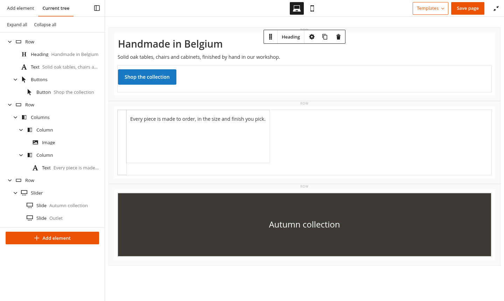

# Mage-OS Page Builder Improved

[](https://github.com/mage-os-lab/module-page-builder-improved/actions/workflows/ci.yml)
[](LICENSE)

`mage-os/module-page-builder-improved`: one composer package with the Mage-OS modules that improve core Page
Builder. Install it to get them all; enable the ones you want.

| Module                                                                     | What it does |
|----------------------------------------------------------------------------|--------------|
| [MageOS_PageBuilderComponents](src/PageBuilderComponents/README.md)            | Page Builder content types declared with PHP attributes on a block class: no content type XML, UI form, preview or master template to write. |
| [MageOS_PageBuilderComponentsExamples](src/PageBuilderComponentsExamples/README.md) | Ready-made components built on it: hero, cards, USP list, image and text, call to action. |
| [MageOS_PageBuilderUi](src/PageBuilderUi/README.md)                            | A fresh new editor UI: a collapsible panel with a block inserter and a list view, the edit form as a tabbed sidebar. |
| [MageOS_PageBuilderLayout](src/PageBuilderLayout/README.md)                    | Layout settings per viewport (column and row gaps, columns per line, flex and grid layouts, justify, align) and a Tablet view on the stage. |



## Requirements

- PHP 8.3 or 8.4
- Magento Open Source / Mage-OS 2.4.8, with Page Builder 2.2.6 (any 2.2.6 patch release)

`composer.json` pins `magento/module-page-builder` to `~2.2.6.0`, the version the modules are tested with, on
purpose: their mixins override private Page Builder APIs (such as `initListeners`, `populateContentTypes` and
`toggleTemplateManger`), and `src/PageBuilderUi/Test/Js/panel.test.js` checks core's `page-builder.html` and
`panel.html` against snapshots of 2.2.6-p5. Magento 2.4.9 and PHP 8.5 need Page Builder 2.2.7: supporting them
means re-syncing the overridden code and the snapshots with 2.2.7 first, then widening the constraint.

## Installation

```
composer require mage-os/module-page-builder-improved
bin/magento module:enable MageOS_PageBuilderComponents MageOS_PageBuilderComponentsExamples \
    MageOS_PageBuilderUi MageOS_PageBuilderLayout
bin/magento setup:upgrade
```

The modules add nothing to the database. `MageOS_PageBuilderComponentsExamples` needs
`MageOS_PageBuilderComponents`; the others stand alone.

In production mode, also run `bin/magento setup:di:compile` and `bin/magento setup:static-content:deploy`: the
modules add admin JavaScript, templates and styles, and a storefront stylesheet.

The package replaces the modules' former packages (`mage-os/module-page-builder-components`,
`-components-examples`, `-ui`, `-layout`).

## Development

From this directory:

```
composer install
composer test        # unit tests, PHPStan (level 8), PHP-CS-Fixer, PHPCS, for every module
npm install --no-save knockout@3.5.1 requirejs@2.3.7 underscore@1.13.8 puppeteer@24.10.0
composer test:js     # the modules' JavaScript tests in Node
node src/PageBuilderComponents/Test/Js/browser.test.js   # in headless Chrome
node src/PageBuilderLayout/Test/Js/browser.test.js
```

Each module's README has its own checks, such as PageBuilderUi's screenshots.

CI (`.github/workflows/ci.yml`) runs these on PHP 8.3 and 8.4, and graycoreio's check-extension workflow (install,
DI compile, coding standard) on Magento 2.4.8.

## Changelog

Release notes are in [CHANGELOG.md](CHANGELOG.md), generated from the commit messages on each release. Each
module also has a changelog with the details of what it adds and changes:
[Components](src/PageBuilderComponents/CHANGELOG.md), [Examples](src/PageBuilderComponentsExamples/CHANGELOG.md),
[Layout](src/PageBuilderLayout/CHANGELOG.md), [UI](src/PageBuilderUi/CHANGELOG.md).

## Contributing

Issues and pull requests are welcome at https://github.com/mage-os-lab/module-page-builder-improved. The workflow,
the checks and what to expect are in [CONTRIBUTING.md](CONTRIBUTING.md). Participation is governed by the
[Contributor Covenant 2.1](CODE_OF_CONDUCT.md).

## Security

Please don't open a public issue for a vulnerability: see [SECURITY.md](SECURITY.md) for the private advisory flow.

## Attribution

The initial idea of the component system in `MageOS_PageBuilderComponents` (declaring a Page Builder content type
with PHP attributes on a block class, with no XML, UI form or templates to write) comes from
[SushyDev's Easy Page Builder](https://github.com/SushyDev/module-easy-page-builder). Thanks to SushyDev for it.
`MageOS_PageBuilderComponents` is an independent implementation of that idea; its
[changelog](src/PageBuilderComponents/CHANGELOG.md) lists where it differs.

## License

[OSL-3.0](LICENSE)
