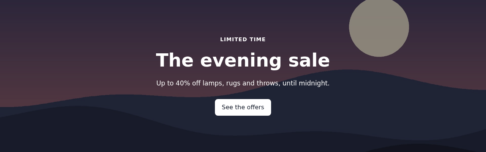
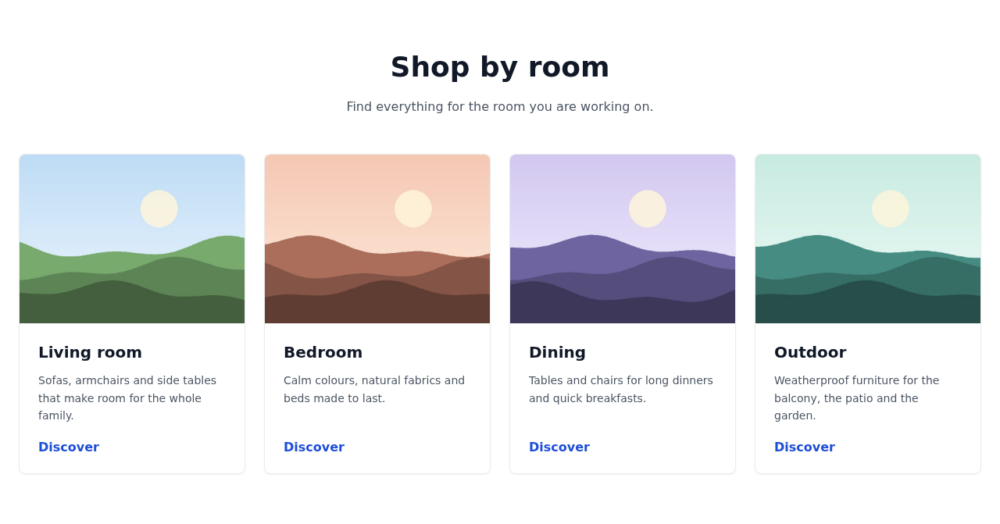
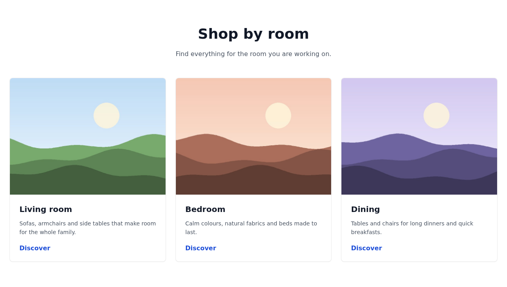
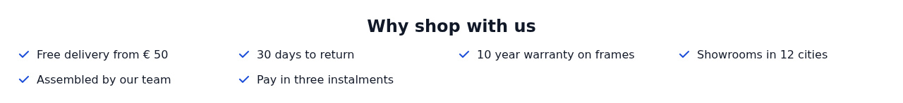
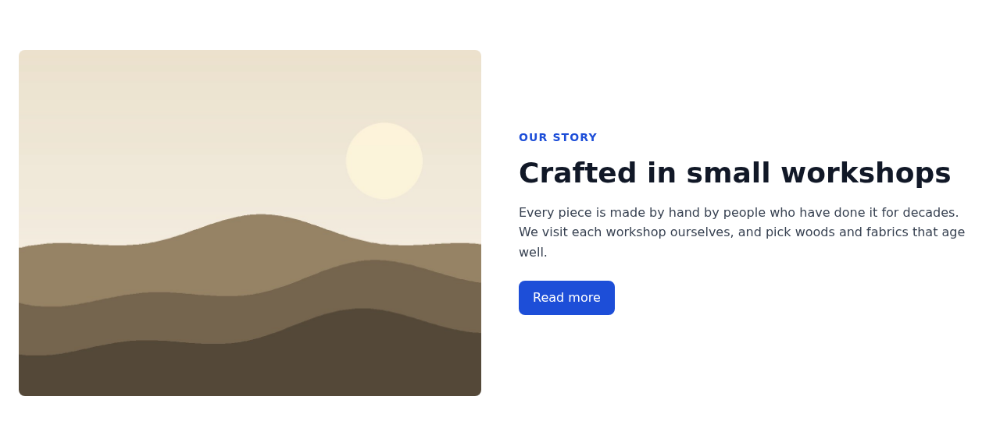
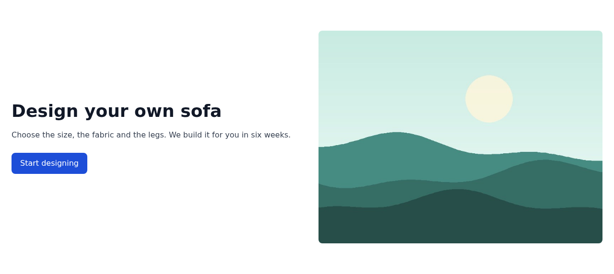
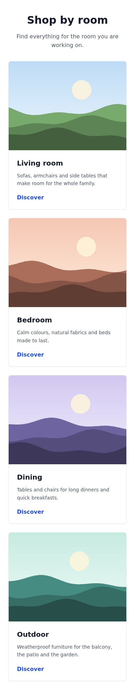
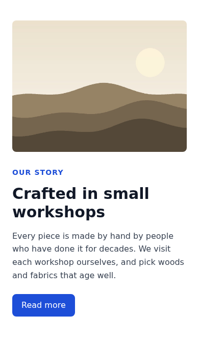

# MageOS Page Builder Components: Examples

Five ready-to-use Page Builder components, built on
[MageOS_PageBuilderComponents](../PageBuilderComponents/README.md). They appear under **Add Content** in the
Page Builder panel. Use them as they are, or read them as examples of how to write your own.

| Component        | Name                    | Fields                                                                     |
|------------------|-------------------------|----------------------------------------------------------------------------|
| Hero             | `mageos_hero`           | Background image and alt text, high priority loading (on by default), eyebrow, title, text, two buttons; text position, height (small to full screen), dark or light text, shade behind the text. |
| Cards            | `mageos_cards`          | Title, intro, 2 to 4 columns, and up to four cards: image and alt text, title, text, link, link text. Without a link text, the whole card links to the card's link. |
| USP List         | `mageos_usp_list`       | Title, one USP per line; in a row, a grid or a list; with or without a check mark. |
| Image & Text     | `mageos_image_text`     | Image and alt text, image on the left or right, eyebrow, title, text, button. |
| Call to Action   | `mageos_call_to_action` | Title, text, two buttons; light, primary color or dark; centered or split. |

Empty fields are left out of the HTML, and a button needs both a link and a text.

## Images

- **Width and height** come from the image file (`getImageSize()`), so the browser reserves the space before the
  image loads. An SVG, a remote URL or a missing file has no known size: the attributes are left out.
- **The Hero's image loads with high priority** (`fetchpriority="high"`): a hero is usually the largest thing at
  the top of the page. For a hero further down, turn off **Load with High Priority (First on Page)** so it does
  not compete with the images above it. It is never lazy loaded, as a hero is rarely far below the fold.
- **Card and Image & Text images load lazily** (`loading="lazy"`, `decoding="async"`).
- **No `srcset`**: Magento has no resizer for CMS (`wysiwyg`) images, only for catalog images, so there is only
  the uploaded file to offer. Upload images at the size they are shown, or override the template to point
  `srcset` at your image CDN.
- **Alt text**: the Hero, each card and Image & Text have an alt text field. Leave it empty for a decorative
  image (`alt=""`).

## What they look like

With the module's own stylesheet, sample content and placeholder photos. Each component's settings change its
look: a few variants are shown.

### Hero

Text left, dark on a shaded photo; or centered, light, smaller:




### Cards

Four, or three, per row on desktop:




### USP List

In a row, or as a grid under a title:




### Image & Text

Image left with an eyebrow, or image right:




### Call to Action

Primary color and centered, or dark and split (text left, buttons right):


### On mobile

| Hero | Cards | Image & Text | Call to Action |
| --- | --- | --- | --- |
|  |  |  |  |

## Requirements

- PHP 8.3 or 8.4, or 8.5 on Magento 2.4.9 / Mage-OS 3.x
- `MageOS_PageBuilderComponents`, in the same package (`mage-os/module-page-builder-improved`)

## Installation

```
composer require mage-os/module-page-builder-improved
bin/magento module:enable MageOS_PageBuilderComponentsExamples
bin/magento setup:upgrade
```

The module adds nothing to the database. Disabling it removes the components from the panel, and content
saved with them is no longer rendered.

## Styling

The components depend on no CSS framework or theme: they work with Luma, Hyvä or any other theme, in its fonts.

- **The templates use only the module's own classes**, BEM style: `mageos-pbc` and `mageos-pbc-<component>` on
  the root, `mageos-pbc-hero__title` for its parts, `mageos-pbc-hero--light` for its options. Shared parts
  (container, title, eyebrow, buttons) are `mageos-pbc__*`. No Tailwind or theme classes, so no build step.
- **`css/components.css` gives them their look**: plain CSS, loaded on every page
  (`layout/default_head_blocks.xml`). Every component also declares it in its `stylesheets`, so the Page Builder
  stage preview shows the components styled.

  It is on every page, even pages without a component, because a component can be anywhere: in a CMS page, a
  CMS block, a widget in a layout container, a product description. Its HTML is often served from the block
  cache, so the components cannot reliably add the stylesheet when they render. It is small (about 13 kB,
  3 kB gzipped) and Magento's CSS merging and minification apply to it.
- **Theme it with custom properties**, e.g. in your theme's CSS:

  ```css
  :root {
      --mageos-pbc-primary: #8a5a2b;   /* buttons, links, eyebrows, icons, the primary call to action */
      --mageos-pbc-on-primary: #fff;   /* text on the primary color */
      --mageos-pbc-radius: 0;          /* corners */
  }
  ```

  Also `--mageos-pbc-text`, `-muted`, `-surface`, `-dark`, `-max-width` and `-gutter`: the stylesheet's header
  lists them.
- **Or bring your own styles**: override any rule with the same classes, or drop the stylesheet in your theme's
  `Magento_Theme/layout/default_head_blocks.xml` with
  `<remove src="MageOS_PageBuilderComponentsExamples::css/components.css"/>` and style the classes yourself
  (in a Hyvä theme, with Tailwind's `@apply` if you like).
- **In a Hyvä theme, merge it into your Tailwind build** to save the extra request: import the module's
  stylesheet in your theme's `web/tailwind/tailwind-source.css`,

  ```css
  @import "../../../../../../../app/code/MageOS/PageBuilderComponentsExamples/view/frontend/web/css/components.css";
  ```

  (adjust the path to where the module is installed, e.g. `vendor/mage-os/module-page-builder-improved/...`),
  then remove the head asset as above. The stage preview loads the theme's `css/styles.css` too, so the
  components stay styled there; their declared `stylesheets` load after it and change nothing.

## Changing a component

- **Its HTML.** Override the template in your theme at the same path, e.g.
  `app/design/frontend/Acme/default/MageOS_PageBuilderComponentsExamples/templates/component/hero.phtml`.
- **Leaving one out.** Set it to null in your module's `etc/di.xml`, with
  `MageOS_PageBuilderComponentsExamples` in your `module.xml` sequence:

  ```xml
  <type name="MageOS\PageBuilderComponents\Model\ComponentRegistry">
      <arguments>
          <argument name="components" xsi:type="array">
              <item name="mageos_usp_list" xsi:type="null"/>
          </argument>
      </arguments>
  </type>
  ```

## Development

The module is part of `mage-os/module-page-builder-improved`: `composer install` and `composer test` (unit
tests, PHPStan level 8, PHP-CS-Fixer, PHPCS) run from the [package root](../README.md), for every module.

The screenshots above come from the components' real templates and stylesheet: `Test/Screenshots/run.sh`
renders them with sample content (`render.php`) and photographs each one in headless Chrome (`shot.js`). It
needs PHP with GD, and Docker:

```
MAGENTO_ROOT=/path/to/magento sh Test/Screenshots/run.sh   # writes docs/screenshots
```

## License

[OSL-3.0](../LICENSE)
