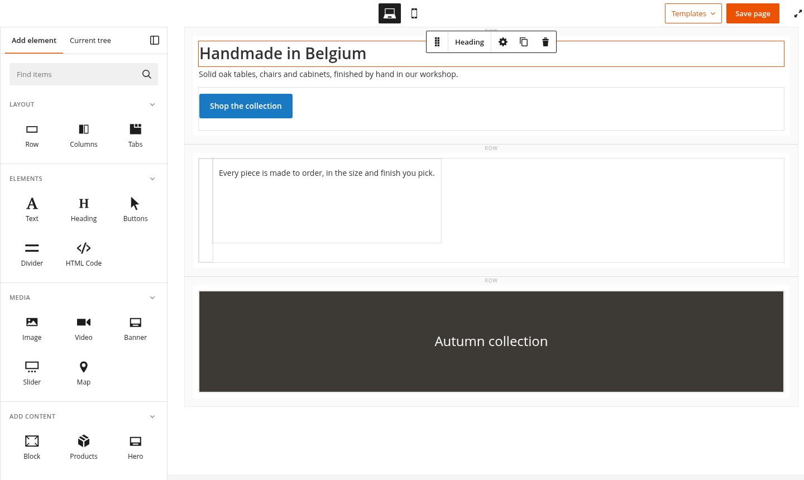
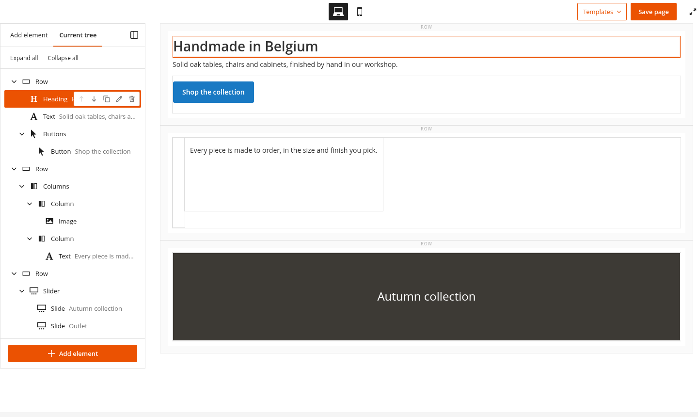
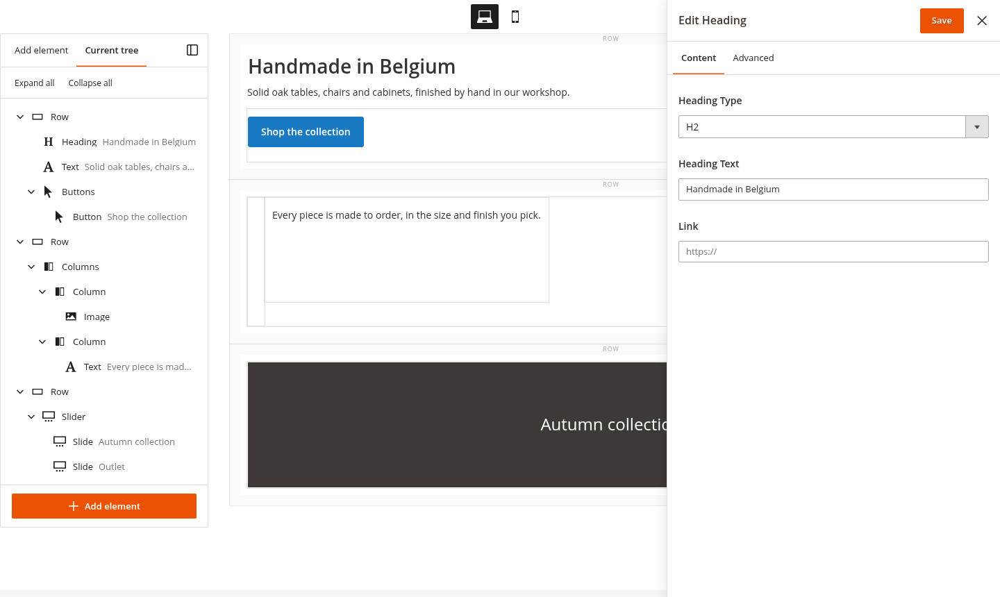
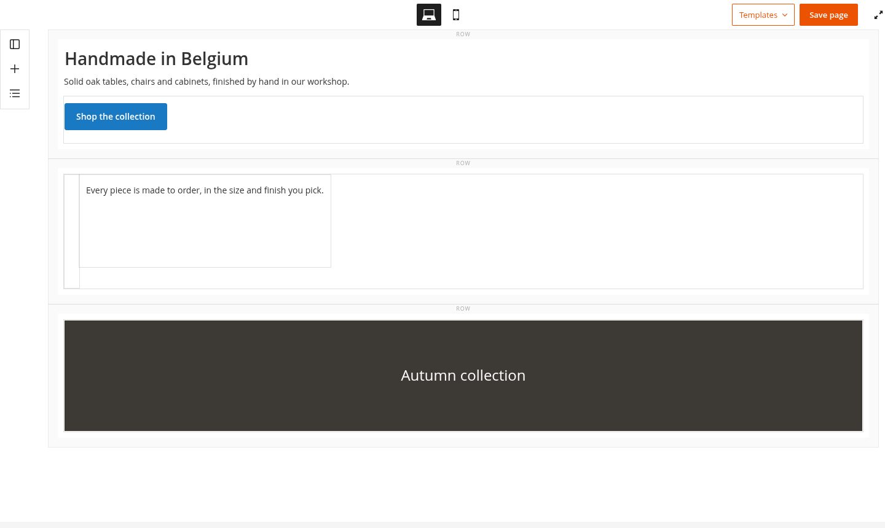
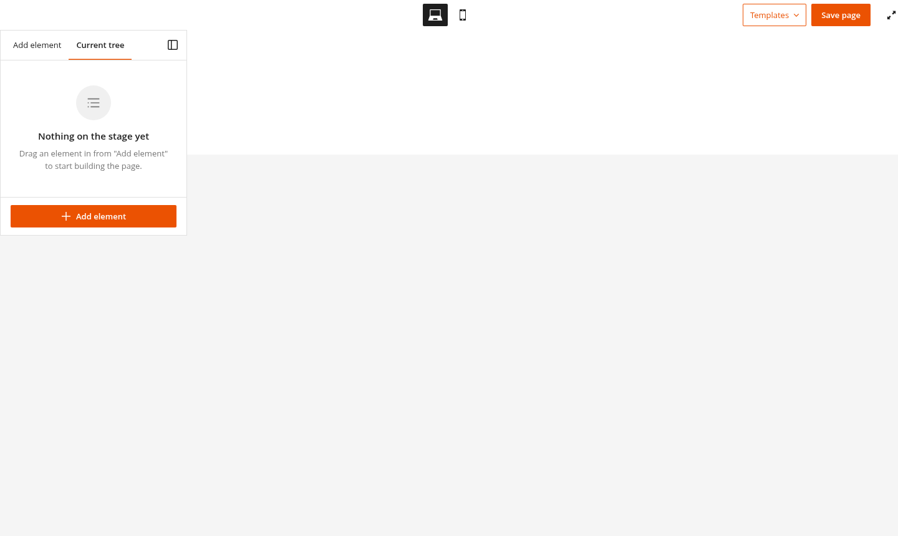
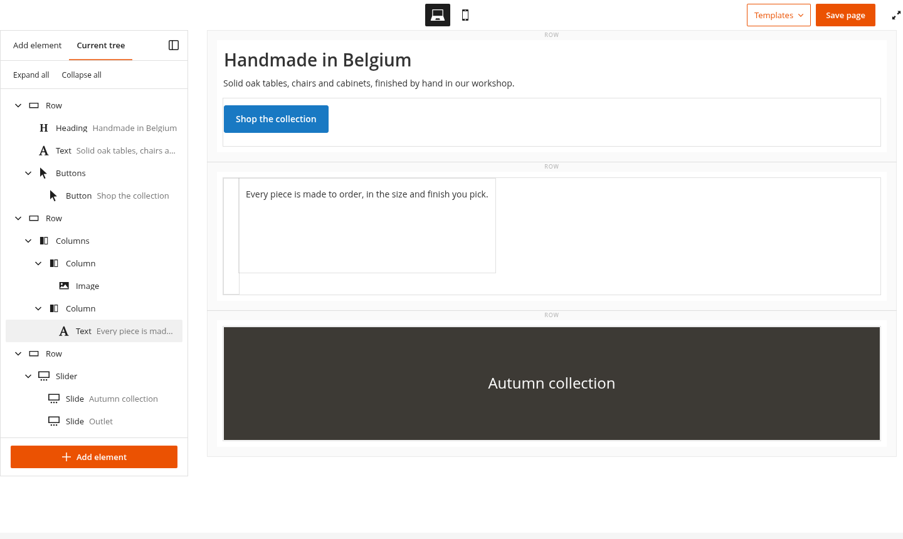
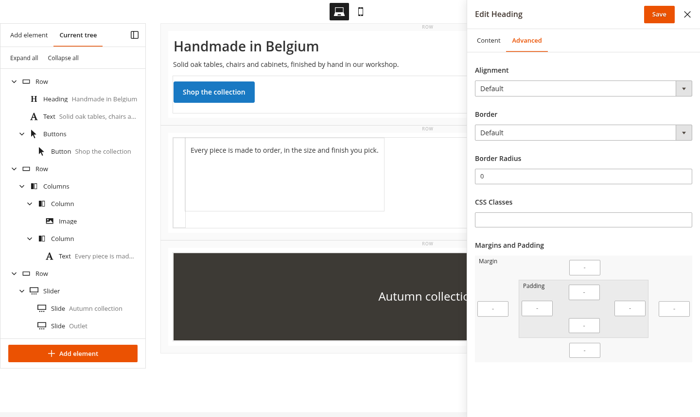
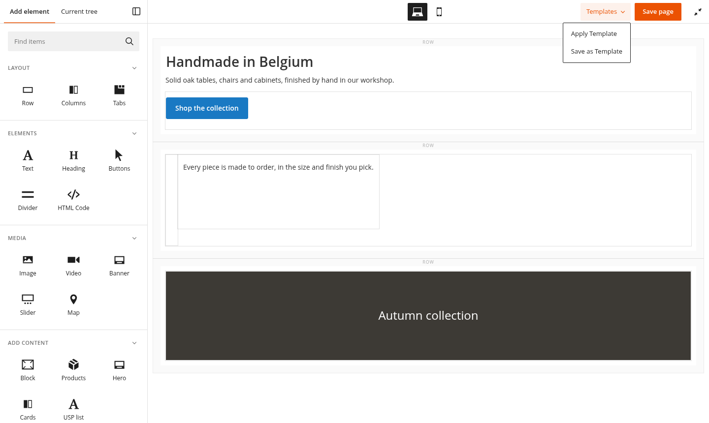
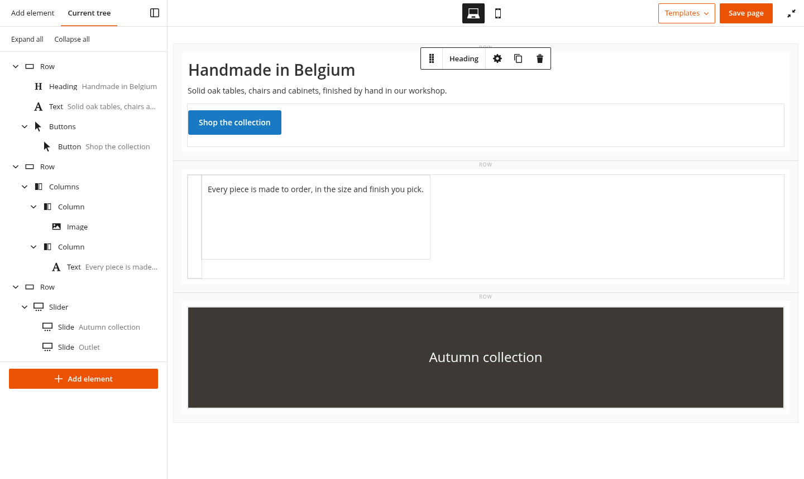

# MageOS Page Builder UI

A fresh new editor UI for Magento's Page Builder: a light, collapsible panel with an inserter of tiles and a list view of the stage, an edit form in a
sidebar with tabs, a header with one templates menu and a "Save page" button, a light toolbar on the stage's
elements, and "Edit with Page Builder" in the CMS grids. Content, content types and saving are Page Builder's
and Magento's own: the module changes the editor's UI only.

| Add element | Current tree | Edit form |
| --- | --- | --- |
|  |  |  |

## Install

```bash
composer require mage-os/module-page-builder-improved
bin/magento module:enable MageOS_PageBuilderUi
bin/magento setup:upgrade
```

It depends on `Magento_PageBuilder`, `Magento_Cms`, `Magento_Ui` and `Magento_Backend`. Admin styles are LESS
(`view/adminhtml/web/css/source/_module.less`), compiled with the backend theme as usual.

## The panel

A mixin on `Magento_PageBuilder/js/panel`, with its own `template/panel.html`.

- **Wider**: 300 px instead of 150, so tiles, labels and the tree fit.
- **Collapsible**: the sidebar button at the top right folds the panel to a 48 px strip and gives the stage the
  room, also in full screen. The strip keeps one icon per tab (plus, list), which opens the panel on that tab.
  The panel remembers, per browser, whether it was collapsed and which tab was open.
- **Tabs** follow the WAI-ARIA tabs pattern: each tab controls its pane, only the open tab is in the tab order,
  and the arrow keys, Home and End move between the tabs (in the collapsed strip, without unfolding the panel).
- **Add element**: a search field, and core's sections (Layout, Elements, Media, Add
  Content, and any added by other modules) as headings over a grid of tiles, icon above label. All sections
  are open; their headings still fold them. Search, sections and dragging are core's, unchanged; the tile
  being dragged keeps its look.
- **Current tree**: the elements on the stage, nested as
  they are, with a short summary of their text. It is a plain, indented list of buttons rather than an ARIA tree,
  as each row holds several buttons; the fold buttons carry `aria-expanded`, the selected node `aria-current`.
  - Hovering a node outlines its element on the stage; hovering an element on the stage marks its node.
  - Clicking a node selects it and scrolls its element into view.
  - Each node can be moved up or down among its siblings, duplicated, edited or removed, from a white bar of
    actions over the end of the row. These run the same code as the element's toolbar on the stage, so each
    element keeps its own rules: an element whose toolbar has no move handle (slides, tabs) can't be moved, and
    the last slide or tab can't be removed.
  - Containers fold open and closed, one by one or all at once ("Expand all", "Collapse all").
  - An empty stage shows a short explanation, and an "Add element" button under the tree leads back to the
    inserter.

| Collapsed | Empty tree | Stage hover marks the node |
| --- | --- | --- |
|  |  |  |

## The edit form

An element's edit form (core's slide-in modal, `Magento_PageBuilder/js/modal/modal`, extended by
`js/modal/modal-mixin.js`) is a 480 px sidebar on the right:

- The title, Save and close share one sticky bar.
- The form's top level fieldsets are **tabs**, like the panel's: "Content" (core's unlabelled "general"
  fieldset), "Advanced", and whatever else the element's form has. A fieldset the form hides (an appearance
  that doesn't use it) has no tab. A tab with an invalid field gets a red dot, and opens when the open tab has
  none. `js/form/tabs.js` follows the form's DOM, as Magento_Ui renders it asynchronously, and again when the
  appearance changes. The tabs are WAI-ARIA tabs, like the panel's: tied to their fieldsets, with the arrow keys,
  Home and End.
- Labels sit above their fields, which take the sidebar's width.

| Content | Advanced |
| --- | --- |
|  |  |

## The header

A mixin on `Magento_PageBuilder/js/page-builder`, with its own `template/page-builder.html` (core's, with the
header's buttons changed):

- **Templates**: "Apply Template" and "Save as Template" in one menu, each shown when the admin user may use it.
  A click anywhere or Escape closes it; Escape gives the focus back to its button.
- **Save page**: the primary action. It clicks the Save (`#save-button`, or `#save`) of the form Page Builder is
  in, so the form's validation and redirect apply: the one in the nearest container around the editor that has
  one, within the modal when the form is in a modal. Every editor of a page saves the page's form; there is no
  button without a Save. Saved from full screen, Page Builder opens in full screen again once the page has
  reloaded: a flag in session storage, kept for a minute, which only the page it was saved from acts on (the same
  edit page, or the new entity's edit page after a "new" page's first save). A save that fails its validation
  doesn't reload, and leaves other pages alone.
- **Full screen**: core's icon, as a button with a label.
- The viewport switcher as icon buttons. In full screen, the header is white and lines up with the panel's tab
  bar, so the two read as one top bar.



## Edit with Page Builder

The CMS pages' and blocks' grids get an "Edit with Page Builder" action after "Edit"
(`Plugin\AddEditWithPageBuilderAction`, set up per grid in `etc/adminhtml/di.xml`; only while Page
Builder is enabled). It opens the edit page with `#edit-with-page-builder`, and Page Builder opens in full screen
as soon as its stage is ready. On a CMS page, the "Content" fieldset is opened first
(`layout/cms_page_edit.xml`), as Page Builder doesn't start inside a closed fieldset.

## The stage

Styles only, scoped to the stage wrapper the panel sits in (`.mageos-panel-host`):

- **Elements' toolbar**: white with a dark 1 px border, square corners, no
  shadow, and the element's name between the move handle and the actions.
- **Hover outline** in the accent colour instead of grey.



## Customising

The colours and sizes are LESS variables at the top of `_module.less`: `@mageos-ui__accent` (Magento's orange,
`#eb5202`), the text, border and hover greys, `@mageos-panel__width`, `@mageos-panel__collapsed-width` and
`@mageos-form__width`.

## Development

The module is part of `mage-os/module-page-builder-improved`: `composer install` and `composer test` (unit
tests, PHPStan level 8, PHP-CS-Fixer, PHPCS) run from the [package root](../README.md), for every module. From
this module's directory:

```bash
# The panel's tree and mixin; needs Knockout (Magento's lib/web/knockoutjs, or `npm install knockout`)
node Test/Js/panel.test.js path/to/magento/module-page-builder path/to/knockout.js

# Screenshots and browser checks without a live admin (needs Docker): the backend theme's styles, core Page
# Builder's admin LESS with the module's, the real templates and mixins next to a stand-in stage and edit form,
# in headless Chrome. Fails on a script error, a missing file or a failed check.
MAGENTO_ROOT=/path/to/magento sh Test/Screenshots/run.sh screenshots
```

The scenarios and their checks are in `Test/Screenshots/shot.js`;
`?tab=add|tree&collapsed=1&fullscreen=1&empty=1&form=1&reopen=1|other` and `#edit-with-page-builder` on
`index.html` set up each one.

### Copies of core's templates

`view/adminhtml/web/template/page-builder.html` and `panel.html` are copies of Magento_PageBuilder's, changed.
`Test/Js/_files/core-templates/` keeps core's versions they were copied from (magento/module-page-builder
2.2.6-p5), and `Test/Js/panel.test.js` fails when the installed core templates differ from them, with the lines
core changed. To pass it again, re-sync the copy: bring core's change into the module's template, then copy the
new core template into `Test/Js/_files/core-templates/` (as `<name>.html.txt`).
